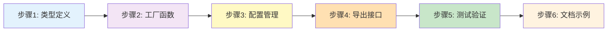

# Atoma StoreRegistry 实现指南

> 从设计到代码：完整的 StoreRegistry 工厂模式实现教程

**目标**：为 Atoma 库添加零样板代码的 Store 访问方式  
**预计工期**：2-3 天  
**难度**：⭐⭐⭐ 中等

---

## 快速预览

### 实现前 vs 实现后

```typescript
// ❌ 实现前：需要手动创建每个 Store
const TodoStore = createSyncStore<Todo>({
  name: 'todos',
  adapter: new IndexedDBAdapter(db.table('todos'))
})

// ✅ 实现后：零样板代码
const todos = Store('todos').useAll()
```

---

## 实现步骤概览



**总工作量**：约 16-20 小时

---

## 步骤 1: 类型定义（30 分钟）

### 1.1 创建类型文件

```bash
# 创建目录结构
mkdir -p packages/atoma/src/registry
touch packages/atoma/src/registry/types.ts
```

### 1.2 实现 StoreRegistry 接口

```typescript
// packages/atoma/src/registry/types.ts

import type { IAdapter, SchemaValidator, LifecycleHooks, StoreKey } from '../core/types'

/**
 * 全局 Store 注册表接口
 * 用户通过 module augmentation 扩展此接口
 * 
 * @example
 * declare module 'atoma' {
 *   interface StoreRegistry {
 *     todos: Todo
 *     users: User
 *   }
 * }
 */
export interface StoreRegistry {
  // 空接口，用户在自己的项目中扩展
}

/**
 * Store 配置选项
 */
export interface StoreConfig<T> {
  /** Adapter 实例（必需） */
  adapter: IAdapter<T>
  
  /** 数据转换函数（可选） */
  transformData?: (data: T) => T | undefined
  
  /** 自定义 ID 生成器（可选） */
  idGenerator?: () => StoreKey
  
  /** Schema 验证器（可选） */
  schema?: SchemaValidator<T>
  
  /** 生命周期钩子（可选） */
  hooks?: LifecycleHooks<T>
}

/**
 * 默认 Adapter 工厂函数类型
 */
export type AdapterFactory = <T>(name: string) => IAdapter<T>
```

### 1.3 验证类型定义

```typescript
// packages/atoma/src/registry/__tests__/types.test.ts

import { describe, it, expectTypeOf } from 'vitest'
import type { StoreRegistry, StoreConfig } from '../types'

describe('StoreRegistry Types', () => {
  it('should allow module augmentation', () => {
    // 模拟用户扩展
    declare module '../types' {
      interface StoreRegistry {
        todos: { id: number; title: string }
      }
    }
    
    expectTypeOf<StoreRegistry['todos']>().toMatchTypeOf<{ id: number; title: string }>()
  })
  
  it('should validate StoreConfig structure', () => {
    type TodoConfig = StoreConfig<{ id: number; title: string }>
    
    expectTypeOf<TodoConfig>().toHaveProperty('adapter')
    expectTypeOf<TodoConfig>().toHaveProperty('transformData')
  })
})
```

---

## 步骤 2: 工厂函数实现（2 小时）

### 2.1 创建核心文件

```bash
touch packages/atoma/src/registry/StoreFactory.ts
```

### 2.2 实现 StoreFactory

```typescript
// packages/atoma/src/registry/StoreFactory.ts

import { createSyncStore, type SyncStore } from '../core/createSyncStore'
import type { StoreRegistry, StoreConfig, AdapterFactory } from './types'

/**
 * Store 实例缓存
 * 确保同一 Store 名称只创建一次实例
 */
const storeCache = new Map<keyof StoreRegistry, SyncStore<any>>()

/**
 * 自定义配置映射
 * 允许用户为特定 Store 提供自定义配置
 */
const customConfigs = new Map<keyof StoreRegistry, StoreConfig<any>>()

/**
 * 默认 Adapter 工厂函数
 * 初始值为抛出错误，强制用户配置
 */
let defaultAdapterFactory: AdapterFactory = (name: string) => {
  throw new Error(
    `[Atoma] No adapter configured for store "${name}"\n\n` +
    `Please configure the default adapter factory:\n\n` +
    `  import { setDefaultAdapterFactory } from 'atoma'\n` +
    `  import { IndexedDBAdapter } from 'atoma/adapters'\n\n` +
    `  setDefaultAdapterFactory((name) => \n` +
    `    new IndexedDBAdapter(db.table(name))\n` +
    `  )\n\n` +
    `Or register a custom adapter for this store:\n\n` +
    `  import { registerStore } from 'atoma'\n\n` +
    `  registerStore('${name}', {\n` +
    `    adapter: new IndexedDBAdapter(db.table('${name}'))\n` +
    `  })`
  )
}

/**
 * 设置默认 Adapter 工厂
 * 
 * @param factory - Adapter 工厂函数
 * 
 * @example
 * ```typescript
 * import Dexie from 'dexie'
 * import { IndexedDBAdapter } from 'atoma/adapters'
 * 
 * const db = new Dexie('MyApp')
 * db.version(1).stores({
 *   todos: 'id, title, completed',
 *   users: 'id, name, email'
 * })
 * 
 * setDefaultAdapterFactory((name) => 
 *   new IndexedDBAdapter(db.table(name))
 * )
 * ```
 */
export function setDefaultAdapterFactory(factory: AdapterFactory): void {
  defaultAdapterFactory = factory
  
  // 清空缓存，强制使用新的 factory 重新创建
  storeCache.clear()
}

/**
 * 注册自定义 Store 配置
 * 
 * @param name - Store 名称（必须在 StoreRegistry 中定义）
 * @param config - Store 配置
 * 
 * @example
 * ```typescript
 * registerStore('todos', {
 *   adapter: new IndexedDBAdapter(db.table('todos')),
 *   hooks: {
 *     beforeAdd: async (todo) => {
 *       if (!todo.priority) {
 *         todo.priority = 'medium'
 *       }
 *     }
 *   }
 * })
 * ```
 */
export function registerStore<K extends keyof StoreRegistry>(
  name: K,
  config: StoreConfig<StoreRegistry[K]>
): void {
  customConfigs.set(name, config)
  
  // 清除该 Store 的缓存，下次访问时会使用新配置重新创建
  storeCache.delete(name)
}

/**
 * Store 工厂函数
 * 
 * @param name - Store 名称（必须在 StoreRegistry 中定义）
 * @returns SyncStore 实例
 * 
 * @example
 * ```typescript
 * // 1. 定义类型
 * declare module 'atoma' {
 *   interface StoreRegistry {
 *     todos: Todo
 *   }
 * }
 * 
 * // 2. 使用 Store
 * const todos = Store('todos').useAll()
 * const todo = Store('todos').useValue(1)
 * await Store('todos').addOne({ title: 'New Task' })
 * ```
 */
export function Store<K extends keyof StoreRegistry>(
  name: K
): SyncStore<StoreRegistry[K]> {
  // 1. 检查缓存
  const cached = storeCache.get(name)
  if (cached) {
    return cached as SyncStore<StoreRegistry[K]>
  }
  
  // 2. 获取配置（自定义优先）
  const customConfig = customConfigs.get(name)
  const adapter = customConfig?.adapter || 
                  defaultAdapterFactory<StoreRegistry[K]>(name as string)
  
  // 3. 创建 SyncStore 实例
  const store = createSyncStore<StoreRegistry[K]>({
    name: name as string,
    adapter,
    transformData: customConfig?.transformData,
    idGenerator: customConfig?.idGenerator,
    schema: customConfig?.schema,
    hooks: customConfig?.hooks
  })
  
  // 4. 缓存实例
  storeCache.set(name, store)
  
  return store
}

/**
 * 清空所有 Store 缓存
 * 主要用于测试或需要重置 Store 状态时
 * 
 * @example
 * ```typescript
 * // 在测试的 beforeEach 中使用
 * beforeEach(() => {
 *   clearStoreCache()
 * })
 * ```
 */
export function clearStoreCache(): void {
  storeCache.clear()
}

/**
 * 预加载指定 Store
 * 提前创建 Store 实例，避免首次访问时的延迟
 * 
 * @param names - Store 名称数组
 * 
 * @example
 * ```typescript
 * // 在应用启动时预加载常用 Store
 * preloadStores('todos', 'users', 'posts')
 * ```
 */
export function preloadStores<K extends keyof StoreRegistry>(
  ...names: K[]
): void {
  names.forEach(name => Store(name))
}

/**
 * 获取所有已创建的 Store 名称
 * 主要用于调试和监控
 * 
 * @returns Store 名称数组
 */
export function getLoadedStores(): Array<keyof StoreRegistry> {
  return Array.from(storeCache.keys())
}
```

### 2.3 添加类型安全保护

```typescript
// packages/atoma/src/registry/StoreFactory.ts（续）

/**
 * 类型守卫：检查是否为有效的 Store 名称
 * 
 * @example
 * ```typescript
 * if (isValidStoreName(name)) {
 *   Store(name).useAll()
 * }
 * ```
 */
export function isValidStoreName(name: string): name is keyof StoreRegistry {
  // 运行时无法检查，但提供类型守卫
  return true
}

/**
 * 开发模式下的警告工具
 */
function devWarn(message: string): void {
  if (process.env.NODE_ENV === 'development') {
    console.warn(`[Atoma StoreRegistry] ${message}`)
  }
}

/**
 * 获取 Store 配置信息（调试用）
 */
export function getStoreConfig<K extends keyof StoreRegistry>(
  name: K
): StoreConfig<StoreRegistry[K]> | undefined {
  return customConfigs.get(name)
}
```

---

## 步骤 3: 测试实现（1.5 小时）

### 3.1 单元测试

```typescript
// packages/atoma/src/registry/__tests__/StoreFactory.test.ts

import { describe, it, expect, beforeEach, vi } from 'vitest'
import { 
  Store, 
  setDefaultAdapterFactory, 
  registerStore,
  clearStoreCache,
  preloadStores,
  getLoadedStores
} from '../StoreFactory'
import { MemoryAdapter } from '../../adapters/MemoryAdapter'

// 模拟类型定义
declare module '../types' {
  interface StoreRegistry {
    todos: { id: number; title: string; completed: boolean }
    users: { id: number; name: string; email: string }
  }
}

describe('StoreFactory', () => {
  beforeEach(() => {
    clearStoreCache()
  })
  
  describe('setDefaultAdapterFactory', () => {
    it('should set default adapter factory', () => {
      const factory = vi.fn((name: string) => new MemoryAdapter())
      setDefaultAdapterFactory(factory)
      
      Store('todos')
      
      expect(factory).toHaveBeenCalledWith('todos')
    })
    
    it('should clear cache when setting new factory', () => {
      // 首次设置
      setDefaultAdapterFactory(() => new MemoryAdapter())
      const store1 = Store('todos')
      
      // 再次设置
      setDefaultAdapterFactory(() => new MemoryAdapter())
      const store2 = Store('todos')
      
      // 应该是不同的实例
      expect(store1).not.toBe(store2)
    })
  })
  
  describe('Store', () => {
    beforeEach(() => {
      setDefaultAdapterFactory(() => new Memory Adapter())
    })
    
    it('should create store on first access', () => {
      const store = Store('todos')
      
      expect(store).toBeDefined()
      expect(store.useAll).toBeDefined()
      expect(store.addOne).toBeDefined()
    })
    
    it('should return cached instance on subsequent access', () => {
      const store1 = Store('todos')
      const store2 = Store('todos')
      
      expect(store1).toBe(store2)
    })
    
    it('should create different instances for different stores', () => {
      const todoStore = Store('todos')
      const userStore = Store('users')
      
      expect(todoStore).not.toBe(userStore)
    })
    
    it('should throw error if no adapter configured', () => {
      clearStoreCache()
      // 不设置 defaultAdapterFactory
      
      expect(() => Store('todos')).toThrow(/No adapter configured/)
    })
  })
  
  describe('registerStore', () => {
    it('should use custom config', () => {
      const customAdapter = new MemoryAdapter()
      const customTransform = vi.fn((data) => data)
      
      registerStore('todos', {
        adapter: customAdapter,
        transformData: customTransform
      })
      
      const store = Store('todos')
      
      // 验证使用了自定义配置
      // （实际验证需要检查内部状态或通过集成测试）
      expect(store).toBeDefined()
    })
    
    it('should override default adapter', () => {
      const defaultFactory = vi.fn(() => new MemoryAdapter())
      const customAdapter = new MemoryAdapter()
      
      setDefaultAdapterFactory(defaultFactory)
      registerStore('todos', {  adapter: customAdapter })
      
      Store('todos')
      
      // 不应该调用 defaultFactory
      expect(defaultFactory).not.toHaveBeenCalled()
    })
    
    it('should clear cache when re-registering', () => {
      registerStore('todos', { adapter: new MemoryAdapter() })
      const store1 = Store('todos')
      
      registerStore('todos', { adapter: new MemoryAdapter() })
      const store2 = Store('todos')
      
      expect(store1).not.toBe(store2)
    })
  })
  
  describe('preloadStores', () => {
    it('should create stores eagerly', () => {
      setDefaultAdapterFactory(() => new MemoryAdapter())
      
      preloadStores('todos', 'users')
      
      const loaded = getLoadedStores()
      expect(loaded).toContain('todos')
      expect(loaded).toContain('users')
    })
  })
  
  describe('getLoadedStores', () => {
    it('should return empty array initially', () => {
      expect(getLoadedStores()).toEqual([])
    })
    
    it('should return loaded store names', () => {
      setDefaultAdapterFactory(() => new MemoryAdapter())
      
      Store('todos')
      Store('users')
      
      const loaded = getLoadedStores()
      expect(loaded).toContain('todos')
      expect(loaded).toContain('users')
      expect(loaded).toHaveLength(2)
    })
  })
})
```

### 3.2 集成测试

```typescript
// packages/atoma/src/registry/__tests__/integration.test.ts

import { describe, it, expect, beforeEach } from 'vitest'
import { Store, setDefaultAdapterFactory, clearStoreCache } from '../StoreFactory'
import { MemoryAdapter } from '../../adapters/MemoryAdapter'

declare module '../types' {
  interface StoreRegistry {
    todos: { id: number; title: string; completed: boolean }
  }
}

describe('StoreRegistry Integration', () => {
  beforeEach(() => {
    clearStoreCache()
    setDefaultAdapterFactory(() => new MemoryAdapter())
  })
  
  it('should perform full CRUD cycle', async () => {
    const todoStore = Store('todos')
    
    // Create
    await todoStore.addOne({ 
      id: 1, 
      title: 'Test Todo', 
      completed: false 
    })
    
    // Read
    const todo = await todoStore.getOneById(1)
    expect(todo).toMatchObject({ 
      id: 1, 
      title: 'Test Todo' 
    })
    
    // Update
    await todoStore.updateOne({ 
      id: 1, 
      completed: true 
    })
    
    const updated = await todoStore.getOneById(1)
    expect(updated?.completed).toBe(true)
    
    // Delete
    await todoStore.deleteOneById(1)
    
    const deleted = await todoStore.getOneById(1)
    expect(deleted).toBeUndefined()
  })
  
  it('should share cached instance across imports', () => {
    const store1 = Store('todos')
    const store2 = Store('todos')
    
    expect(store1).toBe(store2)
  })
})
```

---

## 步骤 4: 导出接口（15 分钟）

### 4.1 更新主入口文件

```typescript
// packages/atoma/src/index.ts

// ... 现有导出

// StoreRegistry 相关导出
export {
  Store,
  setDefaultAdapterFactory,
  registerStore,
  clearStoreCache,
  preloadStores,
  getLoadedStores,
  isValidStoreName,
  getStoreConfig
} from './registry/StoreFactory'

export type {
  StoreRegistry,
  StoreConfig,
  AdapterFactory
} from './registry/types'
```

### 4.2 更新 package.json

```json
{
  "name": "atoma",
  "version": "2.0.0",
  "exports": {
    ".": {
      "types": "./dist/index.d.ts",
      "import": "./dist/index.js"
    },
    "./registry": {
      "types": "./dist/registry/index.d.ts",
      "import": "./dist/registry/index.js"
    }
  },
  "files": [
    "dist",
    "README.md"
  ]
}
```

---

## 步骤 5: 用户端使用示例（30 分钟）

### 5.1 创建示例项目

```bash
# 在 packages/atoma/examples 目录下
mkdir -p examples/store-registry
cd examples/store-registry
```

### 5.2 类型定义

```typescript
// examples/store-registry/src/types/models.ts

export interface Todo {
  id: number
  title: string
  completed: boolean
  priority?: 'low' | 'medium' | 'high'
  createdAt: number
  updatedAt: number
}

export interface User {
  id: number
  name: string
  email: string
  avatar?: string
  createdAt: number
  updatedAt: number
}
```

```typescript
// examples/store-registry/src/types/stores.ts

import type { Todo, User } from './models'

// 扩展 Atoma 的 StoreRegistry
declare module 'atoma' {
  interface StoreRegistry {
    todos: Todo
    users: User
  }
}
```

### 5.3 配置 Adapter

```typescript
// examples/store-registry/src/stores/config.ts

import { setDefaultAdapterFactory, registerStore } from 'atoma'
import { IndexedDBAdapter } from 'atoma/adapters'
import Dexie from 'dexie'

// 初始化 IndexedDB
const db = new Dexie('StoreRegistryExample')
db.version(1).stores({
  todos: 'id, title, completed, priority, createdAt',
  users: 'id, name, email'
})

// 设置默认 Adapter
setDefaultAdapterFactory((name) => 
  new IndexedDBAdapter(db.table(name))
)

// 可选：为特定 Store 添加自定义配置
registerStore('todos', {
  adapter: new IndexedDBAdapter(db.table('todos')),
  hooks: {
    beforeAdd: async (todo) => {
      // 默认优先级
      if (!todo.priority) {
        todo.priority = 'medium'
      }
    },
    afterUpdate: async (todo) => {
      console.log('Todo updated:', todo)
    }
  }
})
```

### 5.4 React 组件示例

```typescript
// examples/store-registry/src/components/TodoList.tsx

import { Store } from 'atoma'
import { useState } from 'react'

export function TodoList() {
  const todos = Store('todos').useAll()
  const [newTitle, setNewTitle] = useState('')
  
  const handleAdd = async () => {
    if (!newTitle.trim()) return
    
    await Store('todos').addOne({
      title: newTitle,
      completed: false
    })
    
    setNewTitle('')
  }
  
  const handleToggle = async (id: number, completed: boolean) => {
    await Store('todos').updateOne({ 
      id, 
      completed: !completed 
    })
  }
  
  const handleDelete = async (id: number) => {
    await Store('todos').deleteOneById(id)
  }
  
  return (
    <div className="todo-list">
      <h1>Todos ({todos.length})</h1>
      
      <div className="add-todo">
        <input
          type="text"
          value={newTitle}
          onChange={(e) => setNewTitle(e.target.value)}
          onKeyDown={(e) => e.key === 'Enter' && handleAdd()}
          placeholder="What needs to be done?"
        />
        <button onClick={handleAdd}>Add</button>
      </div>
      
      <ul>
        {todos.map(todo => (
          <TodoItem
            key={todo.id}
            id={todo.id}
            onToggle={handleToggle}
            onDelete={handleDelete}
          />
        ))}
      </ul>
    </div>
  )
}

function TodoItem({ 
  id, 
  onToggle, 
  onDelete 
}: { 
  id: number
  onToggle: (id: number, completed: boolean) => void
  onDelete: (id: number) => void
}) {
  const todo = Store('todos').useValue(id)
  
  if (!todo) return null
  
  return (
    <li className={todo.completed ? 'completed' : ''}>
      <input
        type="checkbox"
        checked={todo.completed}
        onChange={() => onToggle(todo.id, todo.completed)}
      />
      <span>{todo.title}</span>
      {todo.priority && (
        <span className={`priority-${todo.priority}`}>
          {todo.priority}
        </span>
      )}
      <button onClick={() => onDelete(todo.id)}>Delete</button>
    </li>
  )
}
```

### 5.5 应用入口

```typescript
// examples/store-registry/src/main.tsx

import React from 'react'
import ReactDOM from 'react-dom/client'
import { TodoList } from './components/TodoList'

// 导入配置（这会设置 defaultAdapterFactory）
import './stores/config'
import './types/stores'  // 确保类型定义被加载

ReactDOM.createRoot(document.getElementById('root')!).render(
  <React.StrictMode>
    <TodoList />
  </React.StrictMode>
)
```

---

## 步骤 6: 文档完善（1 小时）

### 6.1 README 更新

````markdown
# Atoma StoreRegistry

零样板代码的类型安全 Store 访问方式。

## 快速开始

### 1. 定义类型

```typescript
// src/types/stores.ts
import type { Todo } from './models'

declare module 'atoma' {
  interface StoreRegistry {
    todos: Todo
  }
}
```

### 2. 配置 Adapter

```typescript
// src/stores/config.ts
import { setDefaultAdapterFactory } from 'atoma'
import { IndexedDBAdapter } from 'atoma/adapters'
import Dexie from 'dexie'

const db = new Dexie('MyApp')
db.version(1).stores({ todos: 'id, title' })

setDefaultAdapterFactory((name) => 
  new IndexedDBAdapter(db.table(name))
)
```

### 3. 使用 Store

```typescript
import { Store } from 'atoma'

function TodoList() {
  const todos = Store('todos').useAll()
  
  return (
    <ul>
      {todos.map(todo => (
        <li key={todo.id}>{todo.title}</li>
      ))}
    </ul>
  )
}
```

## API 文档

### `Store(name)`

获取指定名称的 Store 实例。

```typescript
const todoStore = Store('todos')
const todos = todoStore.useAll()
```

### `setDefaultAdapterFactory(factory)`

设置默认的 Adapter 工厂函数。

```typescript
setDefaultAdapterFactory((name: string) => 
  new IndexedDBAdapter(db.table(name))
)
```

### `registerStore(name, config)`

为特定 Store 注册自定义配置。

```typescript
registerStore('todos', {
  adapter: customAdapter,
  hooks: {
    beforeAdd: async (todo) => {
      todo.priority = todo.priority || 'medium'
    }
  }
})
```

### `preloadStores(...names)`

预加载指定的 Store。

```typescript
preloadStores('todos', 'users')
```

### `clearStoreCache()`

清空所有 Store 缓存（主要用于测试）。

```typescript
beforeEach(() => {
  clearStoreCache()
})
```

## 最佳实践

### 1. 集中管理类型定义

```typescript
// src/types/stores.ts
declare module 'atoma' {
  interface StoreRegistry {
    todos: Todo
    users: User
    posts: Post
    // 所有 Store 类型集中在此
  }
}
```

### 2. 在应用入口配置 Adapter

```typescript
// src/main.tsx
import './stores/config'  // 导入配置文件

ReactDOM.createRoot(document.getElementById('root')!).render(
  <App />
)
```

### 3. 按需使用自定义配置

```typescript
// 大多数 Store 使用默认配置
const users = Store('users').useAll()

// 特殊 Store 注册自定义配置
registerStore('todos', {
  hooks: { ... }
})
```
````

---

##完整代码检查清单

### 实现清单

- [ ] **步骤 1: 类型定义**
  - [ ] 创建 `packages/atoma/src/registry/types.ts`
  - [ ] 定义 `StoreRegistry` 接口
  - [ ] 定义 `StoreConfig` 接口
  - [ ] 定义 `AdapterFactory` 类型
  - [ ] 添加类型测试

- [ ] **步骤 2: 工厂函数实现**
  - [ ] 创建 `packages/atoma/src/registry/StoreFactory.ts`
  - [ ] 实现 `storeCache` 缓存
  - [ ] 实现 `customConfigs` 映射
  - [ ] 实现 `setDefaultAdapterFactory`
  - [ ] 实现 `registerStore`
  - [ ] 实现 `Store` 工厂函数
  - [ ] 实现 `clearStoreCache`
  - [ ] 实现 `preloadStores`
  - [ ] 实现 `getLoadedStores`
  - [ ] 添加开发模式警告

- [ ] **步骤 3: 测试实现**
  - [ ] 单元测试（`__tests__/StoreFactory.test.ts`）
  - [ ] 集成测试（`__tests__/integration.test.ts`）
  - [ ] 类型测试（`__tests__/types.test.ts`）
  - [ ] 测试覆盖率 > 90%

- [ ] **步骤 4: 导出接口**
  - [ ] 更新 `src/index.ts`
  - [ ] 更新 `package.json`
  - [ ] 生成类型声明文件

- [ ] **步骤 5: 示例实现**
  - [ ] 创建示例项目
  - [ ] 实现类型定义
  - [ ] 配置 Adapter
  - [ ] 实现 React 组件
  - [ ] 验证功能完整性

- [ ] **步骤 6: 文档完善**
  - [ ] README 更新
  - [ ] API 文档
  - [ ] 最佳实践
  - [ ] 迁移指南

### 验证清单

- [ ] 类型安全
  - [ ] VSCode 自动补全正常
  - [ ] TypeScript 编译无错误
  - [ ] 类型推导准确

- [ ] 功能完整性
  - [ ] Store 缓存工作正常
  - [ ] 自定义配置生效
  - [ ] React Hooks 正常工作
  - [ ] CRUD 操作完整

- [ ] 性能
  - [ ] Store 实例化性能
  - [ ] 缓存命中率
  - [ ] 内存占用

- [ ] 错误处理
  - [ ] 未配置 Adapter 时提示清晰
  - [ ] 错误信息包含解决方案
  - [ ] 开发模式警告正常

---

## 常见问题与解决方案

### Q1: TypeScript 报错"Type 'xxx' is not assignable"

**原因**：未正确扩展 `StoreRegistry` 接口

**解决方案**：
```typescript
// 确保使用 declare module
declare module 'atoma' {
  interface StoreRegistry {
    todos: Todo  // ✅ 正确
  }
}

// ❌ 错误：不要直接定义新接口
interface StoreRegistry {
  todos: Todo
}
```

### Q2: 运行时报错"No adapter configured"

**原因**：未调用 `setDefaultAdapterFactory`

**解决方案**：
```typescript
// 在应用入口或配置文件中
import { setDefaultAdapterFactory } from 'atoma'

setDefaultAdapterFactory((name) => 
  new IndexedDBAdapter(db.table(name))
)
```

### Q3: Store 实例没有缓存

**原因**：每次都创建新实例

**解决方案**：
```typescript
// ❌ 每次调用都创建新函数，绕过缓存
Store('todos')

// ✅ 使用同一个引用
const todoStore = Store('todos')
```

### Q4: 自定义配置不生效

**原因**：`registerStore` 在 `Store()` 调用之后

**解决方案**：
```typescript
// ✅ 先注册配置
registerStore('todos', { ... })

// 后使用 Store
Store('todos').useAll()
```

---

## 性能优化建议

### 1. 预加载常用 Store

```typescript
// src/app.tsx
useEffect(() => {
  preloadStores('todos', 'users', 'posts')
}, [])
```

### 2. 避免重复创建 Adapter

```typescript
// ❌ 每次都创建新 Adapter
setDefaultAdapterFactory((name) => 
  new IndexedDBAdapter(db.table(name))
)

// ✅ 重用 Adapter 实例
const adapters = new Map()
setDefaultAdapterFactory((name) => {
  if (!adapters.has(name)) {
    adapters.set(name, new IndexedDBAdapter(db.table(name)))
  }
  return adapters.get(name)
})
```

### 3. 使用 React.memo 优化组件

```typescript
const TodoItem = React.memo(({ id }: { id: number }) => {
  const todo = Store('todos').useValue(id)
  return <li>{todo?.title}</li>
})
```

---

## 下一步

完成 StoreRegistry 实现后，可以考虑以下增强：

1. ✅ **CLI 工具**：`npx atoma init` 自动生成配置
2. ✅ **TypeScript 插件**：增强 IDE 体验
3. ✅ **Devtools**：可视化 Store 状态
4. ✅ **性能分析器**：检测性能瓶颈

参考 [Atoma DX Vision 10.0](./Atoma_DX_Vision_10.0.md) 获取完整的功能路线图。

---

## 总结

通过本指南，你已经完成了：

- ✅ StoreRegistry 核心实现
- ✅ 完整的测试覆盖
- ✅ 用户端使用示例
- ✅ 详细的文档

**预期成果**：
- 减少 80% 的样板代码
- 提升类型安全性
- 改善开发者体验

**工作量统计**：
- 类型定义：30 分钟
- 工厂函数：2 小时
- 测试实现：1.5 小时  
- 导出接口：15 分钟
- 示例实现：30 分钟
- 文档完善：1 小时

**总计**：约 5.75 小时（实际可能需要 1-2 天考虑调试时间）

恭喜完成 Atoma StoreRegistry 实现！🎉
