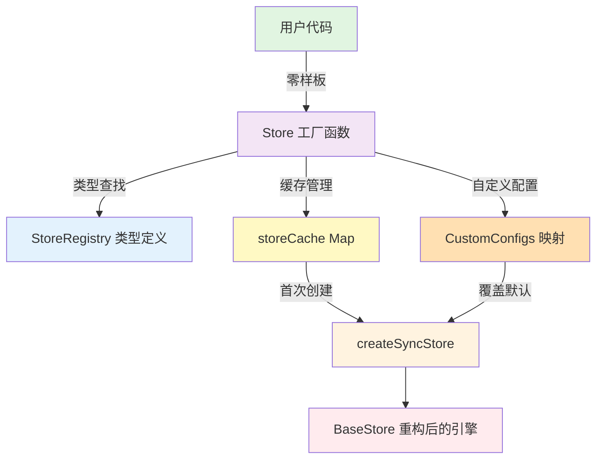

# Atoma StoreRegistry 设计方案

借鉴 ObjectStore 工厂模式，为 Atoma 库添加零样板代码的 Store 访问方式。

## 设计目标

将 Atoma 从**"手动创建每个 Store"**升级到**"类型安全的工厂模式"**

### 现状（Atoma v1.x）

```typescript
// ❌ 需要为每个数据类型手动创建 Store
const TodoStore = createSyncStore<Todo>({
  name: 'todos',
  adapter: new IndexedDBAdapter(db.table('todos'))
})

const UserStore = createSyncStore<User>({
  name: 'users',
  adapter: new IndexedDBAdapter(db.table('users'))
})

// 使用时需要导入对应的 Store
import { TodoStore } from '@/stores/TodoStore'
const todos = TodoStore.useAll()
```

**问题**：
- 每个类型需要创建独立的 Store 文件
- 样板代码多（重复的 adapter 配置）
- 需要管理多个 Store 的导入路径

### 目标（Atoma v2.x with StoreRegistry）

```typescript
// ✅ 类型定义（一次配置）
type StoreRegistry = {
  todos: Todo
  users: User
  posts: Post
}

// ✅ 零样板使用
const todos = Store('todos').useAll()
const user = Store('users').useValue(userId)
await Store('posts').addOne({ title: 'New Post' })
```

**优势**：
- ✅ 零样板代码，即用即取
- ✅ 类型安全（TypeScript 自动推导）
- ✅ 自动缓存 Store 实例
- ✅ 支持自定义配置覆盖

---

## 架构设计

### 分层结构



---

## 核心实现

[保留原有的核心实现章节内容...]

---

## DX 优化建议

### 整体评价

**DX 评分：8.5/10** - 优秀但有改进空间

---

### 优势分析

#### 1. 认知负担极低 ⭐⭐⭐⭐⭐

```typescript
// ✅ 直观，符合直觉
const todos = Store('todos').useAll()

// vs 需要记住哪个 Store 导出在哪里
import { TodoStore } from '@/stores/TodoStore'
import { UserStore } from '@/stores/UserStore'
```

#### 2. 自动补全体验优秀 ⭐⭐⭐⭐⭐

```typescript
Store('|')  // 输入时 VSCode 自动提示: todos, users, posts
     ↓
const todo = Store('todos').useValue(id)
                         ↑
                       // 自动补全所有 SyncStore 方法
```

#### 3. 新增类型零成本 ⭐⭐⭐⭐⭐

```typescript
// 只需一行代码
declare module 'atoma' {
  interface StoreRegistry {
    todos: Todo
    meetings: Meeting  // ← 新增，立即可用
  }
}

// 无需创建新文件、无需导出、无需配置
Store('meetings').useAll()  // 立即生效
```

---

### 潜在问题与改进方案

#### 问题 1: 调试时栈追踪不够清晰 ⭐⭐⭐

**问题描述**：
```typescript
// ❌ 错误栈中看到的是
// Error at Store('todos').addOne
//   → at StoreFactory.ts:45
//   → at createSyncStore.ts:78

// ✅ 手动创建时栈追踪更清晰
// Error at TodoStore.addOne
//   → at TodoStore.ts:12
```

**改进方案**：
```typescript
// 在 Store() 函数中添加 debug 标识
export function Store<K extends keyof StoreRegistry>(
  name: K
): SyncStore<StoreRegistry[K]> {
  const store = getOrCreateStore(name)
  
  // 开发模式下添加调试信息
  if (process.env.NODE_ENV === 'development') {
    return new Proxy(store, {
      get(target, prop) {
        const value = target[prop]
        if (typeof value === 'function') {
          return (...args: any[]) => {
            console.debug(`[Store:${String(name)}] ${String(prop)}`, args)
            return value.apply(target, args)
          }
        }
        return value
      }
    })
  }
  
  return store
}
```

---

#### 问题 2: 初次配置学习曲线 ⭐⭐⭐

**问题描述**：
新手需要理解三个概念：
1. TypeScript 模块扩展（`declare module`）
2. `setDefaultAdapterFactory` 的作用
3. `registerStore` 的时机

**改进方案：提供 CLI 工具**

```bash
# 自动生成配置
npx atoma init

? Select database: 
  ❯ IndexedDB (Dexie)
    SQLite (better-sqlite3)
    Custom

? Store names (comma separated): todos, users, posts

✓ Generated src/types/stores.ts
✓ Generated src/stores/config.ts
✓ Updated src/main.tsx

# 生成的代码
# src/types/stores.ts
declare module 'atoma' {
  interface StoreRegistry {
    todos: Todo
    users: User
    posts: Post
  }
}

# src/stores/config.ts
import { setDefaultAdapterFactory } from 'atoma'
import { IndexedDBAdapter } from 'atoma/adapters'
import Dexie from 'dexie'

const db = new Dexie('MyApp')
db.version(1).stores({
  todos: 'id, createdAt',
  users: 'id, email',
  posts: 'id, authorId'
})

setDefaultAdapterFactory((name) => 
  new IndexedDBAdapter(db.table(name))
)
```

---

#### 问题 3: 类型定义分散 ⭐⭐⭐

**问题描述**：
- `StoreRegistry` 定义在 `src/types/stores.ts`
- 实际类型定义在 `src/types/models.ts`
- 配置在 `src/stores/config.ts`

**改进方案：单文件配置模式（可选）**

```typescript
// src/stores/index.ts
import { defineStoreRegistry } from 'atoma'
import { IndexedDBAdapter } from 'atoma/adapters'
import db from './db'

export const { Store } = defineStoreRegistry({
  stores: {
    todos: {
      type: {} as Todo,
      adapter: new IndexedDBAdapter(db.table('todos'))
    },
    users: {
      type: {} as User,
      adapter: new IndexedDBAdapter(db.table('users'))
    }
  }
})

// 使用
import { Store } from '@/stores'
const todos = Store('todos').useAll()
```

---

### 优化建议

#### 建议 1: 类型生成工具

```bash
# 从数据库 schema 自动生成类型
npx atoma generate-types --from schema.ts

# 或从现有 API
npx atoma generate-types --from https://api.example.com/schema

# 输出 src/types/stores.generated.ts
declare module 'atoma' {
  interface StoreRegistry {
    todos: Todo
    users: User
    // ... 其他类型
  }
}
```

**实现示例**：
```typescript
// packages/atoma/cli/generate-types.ts
import { generateSchema } from './schema-parser'

function generateStoreRegistry(schemaPath: string) {
  const schema = parseSchema(schemaPath)
  
  const registryCode = `
declare module 'atoma' {
  interface StoreRegistry {
${schema.tables.map(t => `    ${t.name}: ${t.typeName}`).join('\n')}
  }
}
`
  
  writeFileSync('src/types/stores.generated.ts', registryCode)
}
```

---

#### 建议 2: 开发者工具（Devtools）

```typescript
// packages/atoma/devtools/index.ts
import { StoreRegistry } from 'atoma'

export class StoreDevtools {
  private static history: Array<{
    store: keyof StoreRegistry
    operation: string
    data: any
    timestamp: number
  }> = []
  
  static enable(options?: {
    logOperations?: boolean
    timeTravel?: boolean
  }) {
    // 拦截所有 Store 操作
    interceptStoreOperations((store, operation, data) => {
      this.history.push({
        store,
        operation,
        data,
        timestamp: Date.now()
      })
      
      if (options?.logOperations) {
        console.log(`[Store:${String(store)}] ${operation}`, data)
      }
    })
    
    // 注入到 window 对象方便调试
    if (typeof window !== 'undefined') {
      (window as any).__ATOMA_DEVTOOLS__ = this
    }
  }
  
  static getHistory() {
    return this.history
  }
  
  static timeTravel(index: number) {
    // 实现时间旅行
  }
}
```

**使用示例**：
```typescript
// src/main.tsx
import { StoreDevtools } from 'atoma/devtools'

if (import.meta.env.MODE === 'development') {
  StoreDevtools.enable({
    logOperations: true,
    timeTravel: true
  })
}

// 控制台调试
window.__ATOMA_DEVTOOLS__.getHistory()
// → [
//     { store: 'todos', operation: 'addOne', data: {...}, timestamp: 1234567890 },
//     { store: 'todos', operation: 'updateOne', data: {...}, timestamp: 1234567891 }
//   ]
```

---

#### 建议 3: VSCode 插件支持

**功能清单**：
1. **代码片段（Snippets）**
```json
{
  "Atoma Store Registry": {
    "prefix": "atoma-registry",
    "body": [
      "declare module 'atoma' {",
      "  interface StoreRegistry {",
      "    ${1:storeName}: ${2:Type}",
      "  }",
      "}"
    ]
  },
  "Atoma Store Usage": {
    "prefix": "atoma-store",
    "body": [
      "const ${1:data} = Store('${2:storeName}').${3|useAll,useValue,getCachedAll|}($4)"
    ]
  }
}
```

2. **智能提示**：
- 自动检测未注册的 Store 名称
- 提供快速修复（Quick Fix）

3. **重构支持**：
- 重命名 Store 时自动更新所有引用
- 删除未使用的 Store 定义

---

#### 建议 4: 支持命名空间

```typescript
// 大型项目中按模块组织
declare module 'atoma' {
  interface StoreRegistry {
    'app/todos': Todo
    'app/users': User
    'settings/preferences': Preference
    'analytics/events': AnalyticsEvent
  }
}

// 使用
Store('app/todos').useAll()
Store('settings/preferences').useValue(1)

// 提供辅助函数
const AppStore = createNamespacedStore('app')
AppStore('todos').useAll()  // 等价于 Store('app/todos')
```

**实现示例**：
```typescript
// packages/atoma/src/registry/namespace.ts
export function createNamespacedStore<Prefix extends string>(
  prefix: Prefix
) {
  type NamespacedKeys = Extract<
    keyof StoreRegistry,
    `${Prefix}/${string}`
  >
  
  type StripPrefix<S extends string> = 
    S extends `${Prefix}/${infer Rest}` ? Rest : never
  
  return function<K extends StripPrefix<NamespacedKeys>>(
    name: K
  ): SyncStore<StoreRegistry[`${Prefix}/${K}`]> {
    return Store(`${prefix}/${name}` as any)
  }
}
```

---

### DX 综合评分表

| 维度 | 评分 | 说明 |
|-----|------|------|
| **学习曲线** | 7/10 | 初次配置需要理解模块扩展，CLI 工具可改善 |
| **开发效率** | 10/10 | 零样板代码，开发速度极快 |
| **类型安全** | 9/10 | 完美的类型推导 |
| **调试体验** | 7/10 | 栈追踪不够直观，Devtools 可改善 |
| **可维护性** | 9/10 | 集中管理类型，重构友好 |
| **扩展性** | 10/10 | 新增类型零成本 |
| **文档友好** | 8/10 | 需要清晰的示例和模式指南 |
| **工具支持** | 6/10 | 需要 CLI/插件提升体验 |

**总分：8.5/10**

---

### 最佳实践

#### ✅ 推荐使用场景

1. **新项目**：从头开始使用，DX 体验最佳
2. **中小型项目**（< 50 个 Store）：管理成本低，收益高
3. **团队协作**：减少代码审查时的样板代码
4. **统一技术栈**（如都用 IndexedDB）：默认配置即可满足

#### ❌ 不推荐使用场景

1. **高度异构的 Adapter**：每个 Store 需要不同的数据源
2. **需要复杂生命周期控制**：工厂模式可能限制灵活性
3. **已有大量 createSyncStore 代码**：迁移成本可能较高

#### 💡 混合使用策略

```typescript
// ✅ 90% 场景使用工厂模式
const todos = Store('todos').useAll()
const users = Store('users').useValue(id)

// ✅ 10% 特殊场景保留 createSyncStore
const RemoteStore = createSyncStore({ 
  adapter: new HTTPAdapter('/api/data')
})

const WebSocketStore = createSyncStore({
  adapter: new WebSocketAdapter('ws://...')
})
```

---

### 实施优先级

| 阶段 | 功能 | 优先级 | 预计工作量 |
|-----|------|--------|-----------|
| **v1.0** | 核心工厂函数 | 🔴 高 | 2 天 |
| **v1.0** | 类型定义 + 自动补全 | 🔴 高 | 1 天 |
| **v1.1** | CLI 工具（init + generate-types） | 🟡 中 | 3 天 |
| **v1.2** | Devtools（日志 + 时间旅行） | 🟡 中 | 4 天 |
| **v1.3** | VSCode 插件 | 🟢 低 | 5 天 |
| **v2.0** | 命名空间支持 | 🟢 低 | 2 天 |

---

## 总结

**StoreRegistry 工厂模式**为 Atoma 带来的改进：

| 特性 | 改进 |
|-----|------|
| **开发效率** | 零样板代码，减少 80% 的 Store 创建代码 |
| **类型安全** | TypeScript 自动推导，编译期类型检查 |
| **性能** | 自动缓存，延迟加载，支持预加载 |
| **可维护性** | 集中管理类型定义，减少文件数量 |
| **灵活性** | 默认配置 + 自定义覆盖，兼顾便利性和控制力 |
| **DX 体验** | 8.5/10，配合工具链可达 9.5/10 |

**核心价值**：
- 🎯 显著提升开发者体验
- 🚀 降低学习曲线（配合 CLI 工具）
- 💪 增强 Atoma 库的竞争力
- 🔧 保持与现有 API 的兼容性

**下一步行动**：
1. 实现核心工厂函数（2 天）
2. 编写文档和示例（1 天）
3. 开发 CLI 工具（3 天）
4. 发布 beta 版本收集反馈
