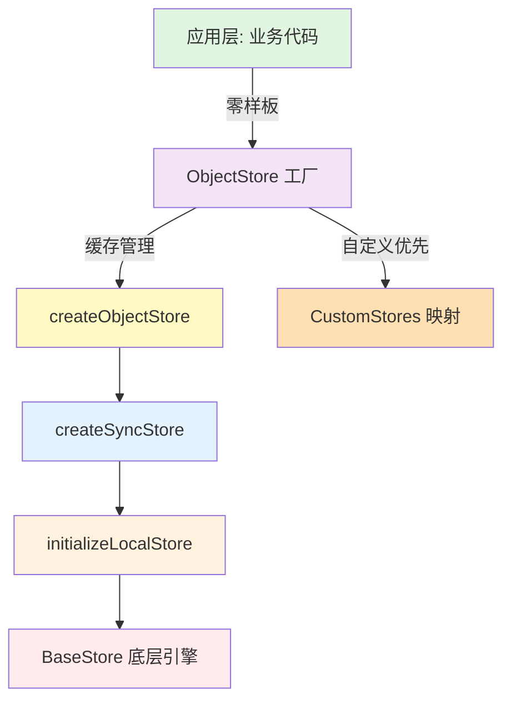

# ObjectStore 工厂模式设计方案

基于 BaseStore 底层引擎，构建更高层的抽象，实现零样板代码的类型安全 Store 访问。

## 设计目标

**核心思想**：从"手动创建每个 Store"到"按需获取 Store 实例"

- ✅ **零样板代码**：`ObjectStore('todo').useValue(id)` 即用即取
- ✅ **类型安全**：TypeScript 自动推导 `ObjectFamily[T]` 类型
- ✅ **自动缓存**：同一类型只创建一次 Store 实例
- ✅ **可扩展**：支持自定义 Store 覆盖默认行为

## 架构分层



## 实现方案

### 1. 类型定义：ObjectFamily 注册中心

```typescript
// 定义所有对象类型的映射
export type ObjectFamily = {
  todo: Todo
  note: Note
  task: Task
  project: Project
  // ... 新增类型只需在此添加
}

// 使用示例（自动类型推导）
const todo = ObjectStore('todo').useValue(id)  // todo: Todo | undefined
const note = ObjectStore('note').useAll()      // note: Note[]
```

**设计要点**：
- 集中管理所有对象类型，新增类型只需添加一行
- TypeScript 自动提供类型安全和自动补全
- 无需手动创建 TodoStore、NoteStore 等样板代码

---

### 2. 工厂函数：缓存 + 自定义覆盖

```typescript
// Store 实例缓存
export const storeMap = new Map<keyof ObjectFamily, any>()

// 工厂函数
export const ObjectStore = <T extends keyof ObjectFamily>(
  type: T
): ObjectStore<T, ObjectFamily[T]> => {
  // 1. 缓存命中检查
  const cached = storeMap.get(type)
  if (cached) {
    return cached
  }
  
  // 2. 自定义 Store 优先（允许覆盖默认行为）
  const customStore = CustomStores[type]
  
  // 3. 创建或使用默认 Store
  const store = customStore?.() || createObjectStore(type)
  
  // 4. 缓存实例
  storeMap.set(type, store)
  
  return store
}
```

**设计要点**：
- **缓存机制**：同一类型只创建一次，避免重复实例化
- **自定义优先**：`CustomStores[type]` 允许特殊对象覆盖默认行为
- **延迟加载**：只有首次访问时才创建 Store（性能优化）

---

### 3. 自定义 Store 注册

```typescript
// CustomStores 映射：针对特殊对象的定制逻辑
const CustomStores: Partial<{
  [K in keyof ObjectFamily]: () => ObjectStore<K, ObjectFamily[K]>
}> = {
  // 示例：note 类型需要特殊的搜索索引
  note: () => createObjectStore('note', {
    onSearch: async (note) => {
      // 自定义搜索内容提取
      return `${note.title} ${note.content}`.toLowerCase()
    },
    afterUpdateProcess: {
      onSuccess: (note) => {
        // note 更新后自动触发搜索索引更新
        SearchHelper.updateDocument(note.id, note.content)
      },
      triggerSearch: true
    }
  }),
  
  // 示例：task 类型需要自动关联 project
  task: () => createObjectStore('task', {
    beforeAddProcess: async (task) => {
      // 自动设置 projectId
      if (!task.projectId) {
        task.projectId = await getDefaultProjectId()
      }
    },
    afterDeleteProcess: (task) => {
      // 删除 task 时自动清理关联数据
      cleanupTaskRelations(task.id)
    }
  })
}
```

**设计要点**：
- 针对特定类型提供生命周期钩子
- 支持搜索索引、关联数据管理等高级功能
- 保持类型安全，TypeScript 会检查钩子参数类型

---

### 4. 默认 Store 创建器

```typescript
const createObjectStore = <T extends keyof ObjectFamily>(
  type: T,
  options?: {
    transformData?: (obj: ObjectFamily[T]) => ObjectFamily[T] | undefined
    beforeAddProcess?: (obj: Partial<ObjectFamily[T]>) => Promise<boolean | void>
    afterUpdateProcess?: {
      onSuccess?: (obj: ObjectFamily[T]) => void
      triggerSearch?: boolean
    }
    // ... 更多生命周期钩子
  }
): ObjectStore<T, ObjectFamily[T]> => {
  const objectsDb = getLocalTable('objects')
  const objectMapAtom = ObjectFamilyAtom(type)
  
  // 基于 initializeLocalStore 构建
  const localStore = initializeLocalStore(objectMapAtom, objectsDb, {
    transformData: options?.transformData
  })
  
  // 包装添加业务逻辑
  const wrappedStore: IStore<ObjectFamily[T]> = {
    addOne: async (obj, opts) => {
      const inited = BaseStore.initBaseObject(obj)
      const canProceed = await options?.beforeAddProcess?.(inited)
      if (canProceed === false) return Promise.reject()
      
      inited.specType = type  // 🔥 自动设置类型标识
      return localStore.addOne(inited, opts)
    },
    
    updateOne: (obj, opts) => {
      options?.beforeUpdateProcess?.(obj)
      return localStore.updateOne(
        (updated) => {
          options?.afterUpdateProcess?.onSuccess?.(updated)
          if (options?.afterUpdateProcess?.triggerSearch) {
            triggerSearchIndex(updated)
          }
        }
      )(obj, opts)
    },
    
    // ... 其他 CRUD 方法
  }
  
  // 创建 React Hooks
  const useValue = (id?: number) => {
    const atom = useMemo(() => {
      if (!id) return atom(undefined)
      
      // 缓存未命中时自动加载
      if (!globalStore.get(objectMapAtom).has(id)) {
        wrappedStore.getOneById(id)
      }
      
      return selectAtom(objectMapAtom, map => map.get(id))
    }, [id])
    
    return useGlobalAtomValue(atom)
  }
  
  const useAll = () => {
    const all = useGlobalAtomValue(objectMapAtom)
    return useMemo(() => Array.from(all.values()), [all])
  }
  
  // 返回完整 Store 接口
  return {
    objectMapAtom,
    useValue,
    useAll,
    getCachedOneById: (id) => globalStore.get(objectMapAtom).get(id),
    ...wrappedStore
  }
}
```

**设计要点**：
- 自动注入 `specType` 字段（对象类型标识）
- React Hooks 自动触发数据加载（首次访问时）
- 提供同步读取方法（`getCachedOneById`）无需异步

---

## 使用示例

### 基本使用

```typescript
// ✅ 零样板代码
function TodoItem({ id }: { id: number }) {
  const todo = ObjectStore('todo').useValue(id)  // 自动加载 + 订阅
  
  if (!todo) return null
  
  return (
    <div>
      <h2>{todo.title}</h2>
      <button onClick={() => {
        ObjectStore('todo').updateOne({ 
          id, 
          completed: !todo.completed 
        })
      }}>
        Toggle
      </button>
    </div>
  )
}
```

### 列表场景

```typescript
function TodoList() {
  const todos = ObjectStore('todo').useAll()  // 订阅所有 todo
  
  return (
    <div>
      <h1>Todos ({todos.length})</h1>
      <button onClick={async () => {
        await ObjectStore('todo').addOne({
          title: 'New Todo',
          completed: false
        })
      }}>
        Add Todo
      </button>
      
      <ul>
        {todos.map(todo => (
          <TodoItem key={todo.id} id={todo.id} />
        ))}
      </ul>
    </div>
  )
}
```

### 跨类型关联

```typescript
function ProjectDashboard({ projectId }: { projectId: number }) {
  const project = ObjectStore('project').useValue(projectId)
  const tasks = ObjectStore('task').useAll()
  
  // 过滤属于该项目的任务
  const projectTasks = useMemo(() => 
    tasks.filter(t => t.projectId === projectId),
    [tasks, projectId]
  )
  
  return (
    <div>
      <h1>{project?.name}</h1>
      <p>Tasks: {projectTasks.length}</p>
    </div>
  )
}
```

### 同步读取（无 React）

```typescript
// 在非组件代码中使用
function deleteProjectWithTasks(projectId: number) {
  const project = ObjectStore('project').getCachedOneById(projectId)
  if (!project) return
  
  // 删除项目下的所有任务
  const tasks = ObjectStore('task').getCachedAll()
  const projectTasks = tasks.filter(t => t.projectId === projectId)
  
  projectTasks.forEach(task => {
    ObjectStore('task').deleteOneById(task.id)
  })
  
  ObjectStore('project').deleteOneById(projectId)
}
```

---

## 进阶功能

### 1. 全局刷新

```typescript
// 刷新所有类型的数据
export const bulkRefreshValue = () => {
  const keys = Array.from(ObjectStoreKeys.values())  // 所有已创建的类型
  keys.forEach(async type => {
    const store = ObjectStore(type)
    await store.getAll()  // 重新从数据库加载
  })
}
```

### 2. 缓存清理

```typescript
// 清空所有 Store 的内存缓存
export const clearAllAtoms = () => {
  const keys = Array.from(ObjectStoreKeys.values())
  keys.forEach(type => {
    const atom = ObjectFamilyAtom(type)
    globalStore.set(atom, new Map())  // 重置为空 Map
  })
}

// 从缓存中移除特定对象
export const removeFromCache = (id: number) => {
  const keys = Array.from(ObjectStoreKeys.values())
  keys.some(type => {
    const atom = ObjectStore(type).objectMapAtom
    const map = globalStore.get(atom)
    if (map.has(id)) {
      globalStore.set(atom, BaseStore.remove(id, map))
      return true  // 找到并移除，停止遍历
    }
  })
}
```

### 3. AtomFamily 优化

```typescript
// 使用 Jotai 的 atomFamily 避免重复创建 atom
export const ObjectFamilyAtom = atomFamily((type: keyof ObjectFamily) => {
  ObjectStoreKeys.add(type)  // 记录已创建的类型
  return atom(new Map<number, ObjectFamily[typeof type]>())
})
```

**设计要点**：
- `atomFamily` 确保同一 `type` 只创建一个 atom
- `ObjectStoreKeys` 记录所有已创建的类型，便于全局操作

---

## 与其他方案对比

### 方案 1: 手动创建 Store（传统方式）

```typescript
// ❌ 需要为每个类型手动创建
const TodoStore = createSyncStore<Todo>({ name: 'todos', adapter })
const NoteStore = createSyncStore<Note>({ name: 'notes', adapter })
const TaskStore = createSyncStore<Task>({ name: 'tasks', adapter })

// 使用
function Component() {
  const todo = TodoStore.useValue(id)
  const notes = NoteStore.useAll()
}
```

**优点**：完全控制，适合需要高度定制的场景  
**缺点**：样板代码多，每个类型都需要手动声明

---

### 方案 2: createSyncStore（中层抽象）

```typescript
// ✅ 一次配置，全部功能
const TodoStore = createSyncStore<Todo>({
  name: 'todos',
  adapter: new IndexedDBAdapter(db.table('todos'))
})

// 使用
function Component() {
  const todos = TodoStore.useAll()
  const todo = TodoStore.useValue(id)
}
```

**优点**：配置简洁，功能完整  
**缺点**：仍需为每个类型创建变量

---

### 方案 3: ObjectStore 工厂（最高层抽象）

```typescript
// ✅ 零样板，即用即取
function Component() {
  const todos = ObjectStore('todo').useAll()
  const note = ObjectStore('note').useValue(id)
  const tasks = ObjectStore('task').getCachedAll()
}

// ✅ 类型安全（TypeScript 自动推导）
const todo = ObjectStore('todo').useValue(id)  // todo: Todo | undefined
const note = ObjectStore('note').useValue(id)  // note: Note | undefined
```

**优点**：
- 零样板代码，开发效率最高
- 类型安全，自动缓存
- 支持自定义覆盖

**缺点**：
- 需要集中管理 `ObjectFamily` 类型定义
- 所有对象共用同一个 adapter（通常是 IndexedDB）

---

## 实现清单

### 必需文件

```typescript
// 1. 类型定义
// src/types/ObjectFamily.ts
export type ObjectFamily = {
  todo: Todo
  note: Note
  task: Task
  // ...
}

// 2. 工厂实现
// src/stores/object/object.store.ts
export const ObjectStore = <T extends keyof ObjectFamily>(type: T) => { ... }

// 3. 自定义 Store
// src/stores/object/custom/index.ts
const CustomStores: Partial<{
  [K in keyof ObjectFamily]: () => ObjectStore<K, ObjectFamily[K]>
}> = {
  note: () => createObjectStore('note', { ... }),
  // ...
}

// 4. 工具函数
// src/stores/object/utils.ts
export const bulkRefreshValue = () => { ... }
export const clearAllAtoms = () => { ... }
export const removeFromCache = (id: number) => { ... }
```

---

## 最佳实践

### 1. 新增对象类型

```typescript
// Step 1: 在 ObjectFamily 中注册类型
export type ObjectFamily = {
  // ... 现有类型
  meeting: Meeting  // 新增
}

// Step 2: 立即可用（无需其他代码）
const meetings = ObjectStore('meeting').useAll()
```

### 2. 添加自定义行为

```typescript
// 在 CustomStores 中添加
const CustomStores = {
  meeting: () => createObjectStore('meeting', {
    beforeAddProcess: async (meeting) => {
      // 自动创建日历事件
      await CalendarAPI.createEvent(meeting)
    },
    afterDeleteProcess: (meeting) => {
      // 删除关联的日历事件
      CalendarAPI.deleteEvent(meeting.calendarEventId)
    }
  })
}
```

### 3. 避免过度缓存

```typescript
// ❌ 不推荐：缓存可能过期
const todo = ObjectStore('todo').getCachedOneById(id)

// ✅ 推荐：自动刷新
const todo = ObjectStore('todo').useValue(id)  // React Hook 自动订阅

// ✅ 可选：强制刷新
const todo = await ObjectStore('todo').getOneById(id, { forceRefresh: true })
```

---

## 未来优化方向

### 1. 支持多 Adapter

```typescript
export const ObjectStore = <T extends keyof ObjectFamily>(
  type: T,
  adapterType?: 'local' | 'remote'
) => {
  const adapter = adapterType === 'remote' 
    ? new HTTPAdapter(`/api/${type}`) 
    : new IndexedDBAdapter(db.table('objects'))
  
  // ...
}
```

### 2. 按需加载（Code Splitting）

```typescript
// 延迟加载 CustomStores
const CustomStores = {
  note: async () => {
    const { NoteStore } = await import('./custom/NoteStore')
    return NoteStore()
  }
}
```

### 3. 细粒度订阅优化

```typescript
// 订阅单个字段变更（减少不必要的渲染）
const todoTitle = ObjectStore('todo').useField(id, 'title')
const todoCompleted = ObjectStore('todo').useField(id, 'completed')
```

---

## 总结

**ObjectStore 工厂模式**是在 BaseStore 底层引擎之上构建的**最高层抽象**：

| 特性 | 说明 |
|-----|------|
| **零样板代码** | `ObjectStore('todo').useValue(id)` 即用即取 |
| **类型安全** | TypeScript 自动推导 `ObjectFamily[T]` 类型 |
| **自动缓存** | 同一类型只创建一次 Store 实例 |
| **可扩展** | 支持 `CustomStores` 覆盖默认行为 |
| **性能优化** | AtomFamily + 延迟加载 + 细粒度订阅 |

**适用场景**：
- ✅ 统一的对象类型系统（如 CRM、笔记应用等）
- ✅ 需要多种对象类型共享相同的 CRUD 逻辑
- ✅ 追求开发效率，减少样板代码

**不适用场景**：
- ❌ 每个 Store 需要完全不同的 adapter 配置
- ❌ 对象类型高度异构，无法统一抽象
